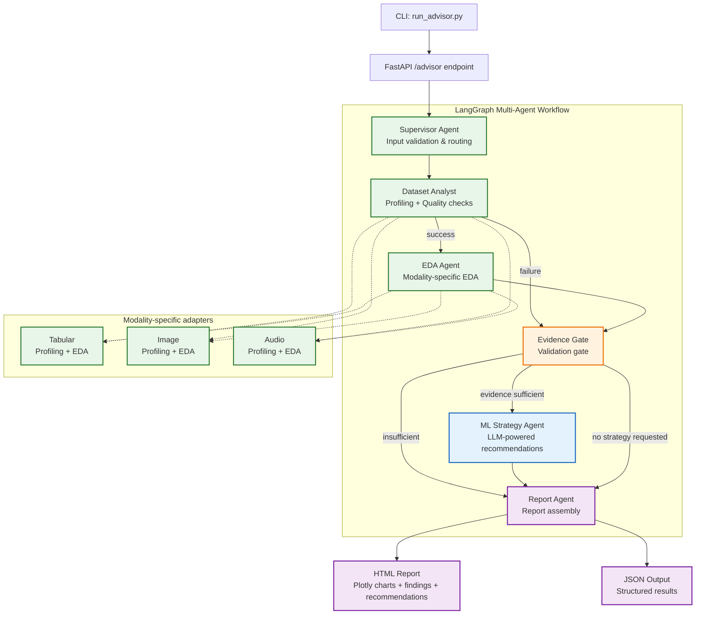

# Agentic Data Science Advisor

An LLM-driven platform that automatically profiles datasets, performs exploratory data analysis (EDA), identifies useful findings, and provides ML strategy recommendations. Generates interactive HTML reports.

**Supported Modalities:** Tabular (CSV, Excel, Parquet), Image (PNG, JPEG, BMP, TIFF, WebP, IDX/GZIP), Audio (WAV, FLAC, OGG, AIFF)

## Problem Statement

Data scientists and analysts spend significant time on repetitive profiling and exploratory analysis before they can begin modeling. This tool automates the initial assessment phase — profiling data quality, generating modality-specific EDA, and producing evidence-grounded ML strategy recommendations — so practitioners can focus on higher-value decisions.

Intended for data scientists, ML engineers, and analysts who want a fast, reproducible first pass on new datasets without writing boilerplate profiling code.

## Features

- **Multi-modal dataset profiling** — Automatic detection and profiling for tabular, image, and audio data
- **Data-quality analysis** — Missing values, duplicates, constant columns, invalid files
- **Modality-specific EDA** — Distributions, charts, and statistics tailored to each modality
- **ML Strategy recommendations** — Evidence-based approach suggestions with validation strategies
- **Interactive HTML reports** — Plotly-powered visualizations, findings, and recommendations
- **Multi-agent workflow** — LangGraph-based orchestration with evidence gates
- **Evidence provenance** — Findings tagged as measured, metadata, methodology, or assumption
- **Automated tests** — 45 tests covering all modalities, truncation, provenance, and error handling

## Architecture

The system uses a LangGraph-based multi-agent workflow orchestrated through a FastAPI backend (and optional CLI). The diagram below shows the implemented flow:



### Agent Responsibilities

| Agent | Type | Responsibility |
|-------|------|----------------|
| **Supervisor** | Deterministic | Validates input, detects modality, determines analysis scope (profile/EDA/strategy) |
| **Dataset Analyst** | Deterministic | Profiles dataset, computes quality metrics, creates structure/quality findings |
| **EDA Agent** | Deterministic | Runs modality-specific exploratory analysis (distributions, charts, statistics) |
| **Evidence Gate** | Deterministic | Validates that required agents succeeded and findings exist before allowing strategy |
| **ML Strategy Agent** | **LLM-dependent** | Generates evidence-grounded ML recommendations using LLM |
| **Report Agent** | Deterministic | Assembles final report (HTML + JSON), determines final advisory status |

**Failure Handling:** If any deterministic agent fails, the Evidence Gate blocks the Strategy Agent and produces a `blocked` or `partial` report with error details. The Strategy Agent is only invoked when all required evidence is available.

## Technology Stack

| Category | Technologies |
|----------|--------------|
| **Core** | Python 3.12+, Pandas, NumPy |
| **ML/Analysis** | Scikit-learn, SciPy |
| **Visualization** | Plotly (interactive HTML), Matplotlib/Seaborn |
| **Agent Orchestration** | LangGraph, LangChain |
| **Image Processing** | Pillow |
| **Audio Processing** | soundfile (libsndfile) |
| **Testing** | Pytest |
| **API** | FastAPI, Uvicorn |
| **Containerization** | Docker, Docker Compose |

## Quick Start

### Prerequisites

- Python 3.12+
- Docker (optional, for containerized deployment)
- FreeLLMAPI-compatible API key for ML strategy recommendations

### Local Development

```bash
# Create and activate virtual environment
python3 -m venv .venv
source .venv/bin/activate

# Install dependencies
python -m pip install -r requirements.txt

# Set up API key (required for ML strategy recommendations)
echo "FREELLMAPI_API_KEY=your-key-here" > .env
echo "FREELLMAPI_BASE_URL=http://localhost:3001/v1" >> .env  # optional, defaults to this
echo "FREELLMAPI_MODEL=auto" >> .env  # optional, defaults to this

# Run tests
python -m pytest tests/ -v
```

### Using Docker

```bash
# Build and run tests
docker compose up --build app

# Run advisor on a dataset
docker compose run --rm advisor \
  --file /app/data/fashion-mnist-master/data/fashion \
  --modality image \
  --request "Recommend ML approaches for image classification" \
  --reports-dir /app/reports/fashion-mnist

# Start the web API
docker compose up --build api
# Access at http://localhost:8000
```

## Usage

### Command Line Interface

```bash
# Tabular dataset (CSV, Excel, Parquet)
python -m app.agents.run_advisor \
  --file data/bank+marketing/bank/bank-full.csv \
  --modality tabular \
  --request "Predict term deposit subscription" \
  --reports-dir reports/bank

# Image dataset (standard files or IDX/GZIP like MNIST/Fashion-MNIST)
python -m app.agents.run_advisor \
  --file data/fashion-mnist-master/data/fashion \
  --modality image \
  --request "Recommend ML approaches for image classification" \
  --reports-dir reports/fashion

# Audio dataset
python -m app.agents.run_advisor \
  --file data/ESC-50-master \
  --modality audio \
  --request "Recommend approaches for environmental sound classification" \
  --reports-dir reports/esc50

# Profile-only (skip EDA and strategy)
python -m app.agents.run_advisor \
  --file data/bank+marketing/bank/bank-full.csv \
  --modality tabular \
  --request "Only profile this dataset" \
  --reports-dir reports/bank-profile
```

### Web Interface

Start the API server and open `http://localhost:8000` in a browser:

```bash
docker compose up --build api
# or locally:
python -m uvicorn app.api.main:app --host 0.0.0.0 --port 8000
```

The web interface provides drag-and-drop upload, modality selection, objective input, and displays results with download links for HTML/JSON reports.

### Arguments

| Argument | Required | Description |
|----------|----------|-------------|
| `--file` | Yes | Path to dataset file or directory |
| `--modality` | No | `tabular`, `image`, or `audio` (auto-detected if omitted) |
| `--request` | Yes | Natural language description of what you want to learn |
| `--reports-dir` | No | Output directory (default: `reports`) |

### Output

Each run generates:
- `advisor_results.json` — Structured results for programmatic use
- `advisor_report.html` — Interactive HTML report with charts, findings, and recommendations

Open the HTML report in a browser to explore:
- Dataset overview with key metrics
- Exploratory data analysis charts
- Key findings with supporting evidence
- ML strategy recommendations with rationale and next steps
- Agent execution log

## Supported Modalities

| Modality | Supported Inputs | Analysis Capabilities |
|---|---|---|
| **Tabular** | CSV, Excel, Parquet | Dataset profiling, data-quality checks, distributions, correlations, and target-aware EDA |
| **Image** | PNG, JPEG, BMP, TIFF, WebP, supported IDX/GZIP formats | Image statistics, dimensions, dataset splits, class distributions, and visualizations where supported |
| **Audio** | WAV, FLAC, OGG, AIFF | Audio metadata, duration, configuration, amplitude statistics, and EDA where supported |

## Demo Datasets (not included in repo)

| Dataset | Modality | Size | Status |
|---|---|---|---|
| Fashion-MNIST (IDX/GZIP) | Image | 70,000 images | ✅ Full workflow |
| Bank Marketing (CSV) | Tabular | 45,211 rows | ✅ Full workflow |
| ESC-50 (WAV) | Audio | 2,000 files | ✅ Full workflow |

> **Note:** Datasets are not included in the repository due to size. Download separately and place in `data/` directory.

## Limitations and Scope

- **No model training:** The platform profiles datasets, performs EDA, and recommends ML approaches. It does not train or evaluate models.
- **IDX compatibility:** IDX support targets standard MNIST/Fashion-MNIST IDX formats; custom variants may not be supported.
- **Audio metadata:** Class labels and dataset folds require a compatible metadata CSV when needed for the analysis.
- **LLM context limits:** Evidence supplied to the strategy agent is capped at 50 items per collection (profile/eda/findings) to manage context size. The generated JSON and HTML reports retain full details; the strategy agent receives a summarized version with truncation noted.
- **305-image limitation (known):** Large image directories (e.g., 300+ individual files) may exceed the LLM context window even after truncation, potentially causing the strategy agent to fail. This is a known limitation of the current implementation. The Fashion-MNIST IDX format (compressed) works around this by storing data compactly.
- **Planned integrations:** FastAPI, PostgreSQL, and RAG are not currently implemented beyond the basic API endpoints.
- **No model training/evaluation:** The platform provides analysis and recommendations only; it does not train or evaluate models.

## Project Structure

```
agentic-ds-ml/
├── app/
│   ├── agents/           # LangGraph workflow & CLI
│   │   ├── run_advisor.py
│   │   ├── advisor_workflow.py
│   │   ├── llm_client.py
│   │   └── check_llm.py
│   ├── api/              # FastAPI backend
│   │   └── main.py
│   ├── tools/            # Analysis & reporting
│   │   ├── multimodal.py         # Image/audio profiling + EDA
│   │   ├── dataset_metadata.py   # IDX/GZIP reader (MNIST/Fashion-MNIST)
│   │   ├── profiling.py          # Tabular profiling
│   │   ├── data_quality.py       # Data quality checks
│   │   ├── eda.py                # Tabular EDA
│   │   └── reporting.py          # HTML report generation
│   ├── schemas/          # Pydantic models (with provenance)
│   └── static/           # Web frontend (HTML/CSS/JS)
├── data/                 # Sample datasets (not committed)
├── reports/              # Generated HTML/JSON reports
├── tests/                # 45 pytest tests
├── .github/workflows/    # CI configuration
├── .gitignore
├── requirements.txt
├── Dockerfile
├── docker-compose.yml
└── README.md
```

## Development

### Running Tests

```bash
python -m pytest tests/ -v
```

All 45 tests pass (30 original + 15 API tests covering truncation, provenance, and finding references).

### Adding New Modalities

1. Add profiling/EDA functions in `app/tools/multimodal.py`
2. Update modality detection in `app/agents/run_advisor.py`
3. Add routing in `app/agents/advisor_workflow.py` supervisor
4. Add chart generation in `app/tools/reporting.py`

## License

MIT License — see LICENSE file for details.

## Security

- Never commit API keys, passwords, environment files, or private datasets. The `.gitignore` excludes `.env`, `data/`, and `reports/`.
- The API does not expose API keys in responses or logs.
- File uploads are limited to 100 MB and validated for allowed extensions.
- ZIP extraction includes path traversal protection.

## GitHub Actions CI

The project includes a minimal CI workflow (`.github/workflows/ci.yml`) that:
- Runs on pushes and pull requests to `main`
- Uses Python 3.12
- Installs dependencies from `requirements.txt`
- Runs the full test suite (`python -m pytest tests/ -q`)
- Does not require external API keys or paid services

## Contributing

1. Fork the repository
2. Create a feature branch
3. Make changes with tests
4. Run `python -m pytest tests/ -q` to verify
5. Submit a pull request

---

**Agentic Data Science Advisor** — Automated profiling, EDA, and ML strategy recommendations for multimodal datasets.